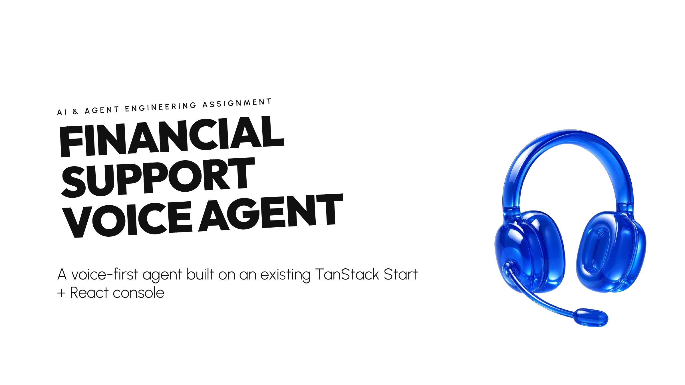
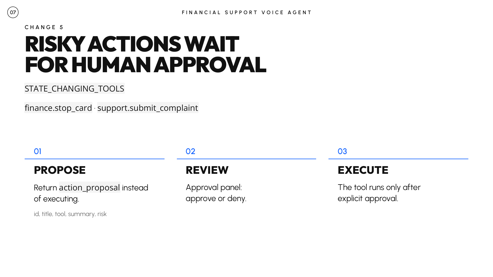
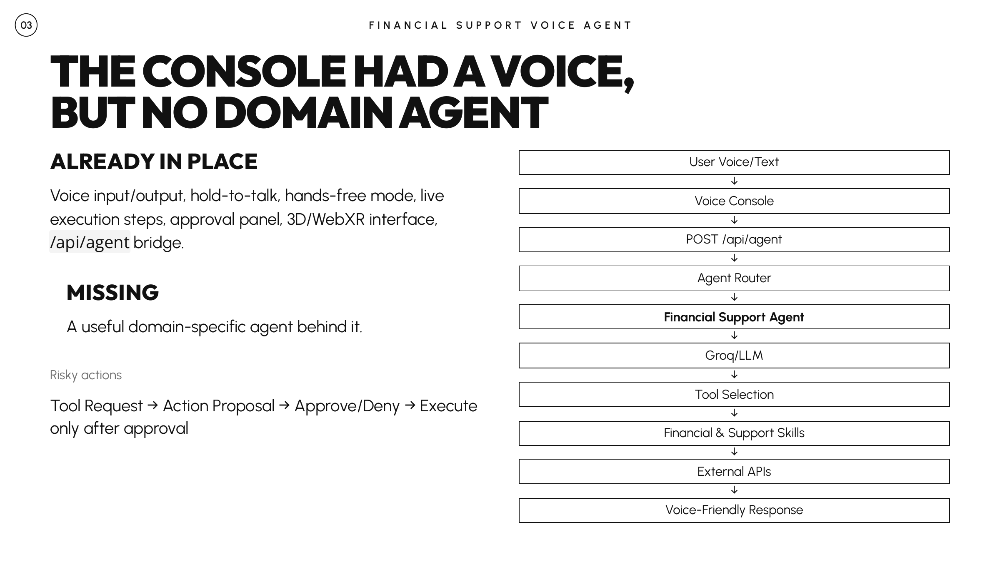

<p align="center">
  
</p>

# Financial Support Voice Agent — OpenClaw Assignment

> **A working, natural-sounding financial support agent** that listens, thinks out loud, and asks before it acts.

## What I Built

A **Financial Support Voice Agent** that demonstrates real agent engineering on OpenClaw:

### The Core Agent
- Listens to customers in Arabic or English
- Answers questions about account balances, cards, and complaints
- Uses real tools connected to a persistent database (SQLite)
- Asks for approval before doing anything risky (stopping cards, filing complaints)
- Shows its work step-by-step in the console

### The Skills (Real Tools, Not Just Chat)
1. **finance.get_accounts** — List customer accounts (checking, savings, etc.)
2. **finance.get_account_balance** — Get current balance from the database
3. **finance.list_cards** — Show all cards with masked last 4 digits
4. **finance.get_card_status** — Check if a card is active or stopped
5. **finance.stop_card** — Stop a card (with approval required + read-after-write verification)
6. **finance.create_account** — Create new account for any customer (with approval required)
7. **finance.deposit** — Deposit money into an account (with approval required)
8. **support.submit_complaint** — File a complaint (with approval required, generates real ID)
9. **support.follow_complaint** — Look up complaint status by ID
10. **support.is_live_chat_available** — Check if live support is available

### The Sandbox
- **Persistent SQLite database** (`data/financial-sandbox.db`)
- Seeded with realistic demo data (accounts, cards, complaints)
- All reads come from the database (never invented balances)
- All writes actually change state (persisted across restarts)
- Can be reset with `npm run sandbox:reset`

---

## How It Works

### The User Talks

```text
User (voice): "رصيدي كام؟" (What's my balance?)
```

### The Console Listens & Routes

1. Speech → text via Groq Whisper
2. Text sent to `/api/agent` with `agent: "financial-support"`
3. Routes to `runFinancialAgent()` in `openclaw/agents/financial-support/agent.ts`

### The Agent Thinks

1. Receives system prompt (rules about tools, language, approval flow)
2. Calls LLM with the turn history
3. LLM decides: "I should call `finance.get_account_balance`"

### The Tool Runs

```text
Tool: finance.get_account_balance
→ Skill: openclaw/skills/finance/get-account-balance.ts
→ Repository: sandboxRepository.getBalance()
→ Database: SELECT balance FROM accounts WHERE id = "ACC-001"
→ Result: 12500.50 EGP
```

### The Agent Replies

```text
Screen:
  text: "رصيد الحساب الجاري هو 12,500.50 جنيه مصري."
  choices: []
  navigation: ["home"]
```

### The Console Speaks

```text
Voice (aloud): "رصيد الحساب الجاري هو 12,500.50 جنيه مصري."
```

---

## Key Decisions & Trade-Offs

### 1. Why SQLite Instead of External APIs?

**Decision:** Built a local sandbox with SQLite instead of calling real bank APIs.

**Why:**
- External banking APIs add credentials, availability, and latency concerns
- SQLite gives the demo a deterministic **source of truth**
- Read-after-write verification works instantly (stop card → check card status)
- Demo state persists across requests and restarts

**Trade-off:** The project is a sandbox/demo environment rather than a real banking integration. The agent never fabricates balances or state; values come from the persistent sandbox.

### 2. Why Groq Instead of OpenAI?

**Decision:** Used Groq as the LLM provider through an OpenAI-compatible API.

**Why:**
- Low-latency model inference
- OpenAI-compatible tool-calling interface
- Easy to swap providers later
- Configured in `/api/agent` for the Financial Support Agent

**Trade-off:** Free-tier rate limits can affect reliability, so provider errors are surfaced honestly instead of replaced with fake results.

### 3. Why Approval Flow?

**Decision:** State-changing operations require explicit human approval.

**Examples:**
- `finance.stop_card`
- `finance.create_account`
- `finance.deposit`
- `support.submit_complaint`

<p align="center">
  
</p>

**Why:**
- Stopping a card changes user-visible state
- Filing a complaint creates a persistent record
- Depositing money changes account state
- Account creation produces a new persistent entity
- The console already provides an approval panel

**Implementation:**
- Agent returns `action_proposal` instead of executing immediately
- Console shows **Approve / Deny**
- On Approve, the tool executes
- On Deny, no state mutation happens
- After important writes, the agent reads the state back to verify it

### 4. Why Read-After-Write Verification?

**Decision:** After a risky state change, read the updated state back from the database.

**Why:**
- Ensures the write actually succeeded
- Returns verified state to the user
- Makes failures visible instead of assuming success

**Example:**
- `stop_card()` updates the card
- `get_card_status()` re-reads the card
- The agent only confirms the final state after verification

### 5. Why a Sandbox Identity Model?

**Decision:** Keep the real console user separate from the seeded demo customer.

**Why:**
- The system does not perform real customer authentication
- The sandbox provides repeatable demo data
- The agent must never claim it knows the real user's identity

**Behavior:**
- Customer-specific financial data comes from tools
- The current session may be associated with a demo customer profile
- If asked whether the data is real, the agent explains that it is sandbox/demo data

---

## Architecture

<p align="center">
  
</p>

```text
┌─ Console (src/routes/index.tsx) ─────────────────┐
│ - Voice input                                    │
│ - Live steps display                             │
│ - Approval panel (Approve/Deny)                 │
│ - Voice output (TTS)                             │
└─────────────────────┬────────────────────────────┘
                      │
                      ↓ POST /api/agent
         ┌─ /api/agent.ts ───────────────────────┐
         │ Routes to agent                       │
         │ financial-support → runFinancialAgent │
         └─────────────────┬─────────────────────┘
                           │
         ┌─ agent.ts ──────↓─────────────────────┐
         │ runFinancialAgent()                   │
         │ - Receives turns                      │
         │ - Calls LLM                           │
         │ - Handles tool calls                  │
         │ - Returns screens / proposals         │
         └─────────────────┬─────────────────────┘
                           │
         ┌─────────────────↓─────────────────────┐
         │ executeTool()                         │
         │ - finance.get_account_balance         │
         │ - finance.stop_card                   │
         │ - finance.create_account              │
         │ - finance.deposit                     │
         │ - support.submit_complaint            │
         │ - ...                                 │
         └─────────────────┬─────────────────────┘
                           │
         ┌─────────────────↓─────────────────────┐
         │ Skill Layer (openclaw/skills/)        │
         │ Typed finance & support skills        │
         └─────────────────┬─────────────────────┘
                           │
         ┌─────────────────↓─────────────────────┐
         │ Repository (sandbox-db.ts)            │
         │ SQLite database operations            │
         └─────────────────┬─────────────────────┘
                           │
         ┌─────────────────↓─────────────────────┐
         │ SQLite Database                       │
         │ data/financial-sandbox.db             │
         │ - customers                           │
         │ - accounts                            │
         │ - cards                               │
         │ - complaints                          │
         └───────────────────────────────────────┘
```

---

## File Structure

```text
openclaw/
├── agents/
│   └── financial-support/
│       ├── agent.ts              ← Main agent runner / orchestration
│       ├── prompt.ts             ← System prompt, safety, language rules
│       ├── tools.ts              ← Tool definitions exposed to the LLM
│       └── agent-identity.test.ts
├── skills/
│   ├── finance/
│   │   ├── get-accounts.ts
│   │   ├── get-account-balance.ts
│   │   ├── list-cards.ts
│   │   ├── get-card-status.ts
│   │   ├── stop-card.ts
│   │   ├── create-account.ts
│   │   └── deposit.ts
│   └── support/
│       ├── submit-complaint.ts
│       ├── follow-complaint.ts
│       └── is-live-chat-available.ts
└── shared/
    ├── sandbox-db.ts             ← SQLite repository + schema
    ├── sandbox-context.ts        ← Demo identity/session context
    ├── api-client.ts             ← Shared/legacy API client
    └── sandbox-db.test.ts
```

---

## Safety Model

### Read-Only Tools
These can run immediately:

- `finance.get_accounts`
- `finance.get_account_balance`
- `finance.list_cards`
- `finance.get_card_status`
- `support.follow_complaint`
- `support.is_live_chat_available`

### State-Changing Tools
These require human approval:

- `finance.stop_card`
- `finance.create_account`
- `finance.deposit`
- `support.submit_complaint`

### Core Rule

> **The model decides what should happen. The runtime decides what is allowed to happen.**

For consequential operations:

```text
User request
→ LLM selects tool
→ Agent creates action_proposal
→ Human Approves / Denies
→ Execute only after approval
→ Read back state
→ Return verified result
```

---

## Tool Calling

The agent uses the OpenAI/Groq tool-calling format correctly.

```text
assistant.tool_calls[n].id
        ↓
tool.tool_call_id
```

The tool result is always linked to the original tool call.

This prevents broken follow-up messages and keeps internal tool protocol details out of the UI.

---

## Response Normalization

LLM output can vary, so the agent includes a defensive normalization layer.

`normalizeAgentResponse()` supports:

- Full structured JSON
- JSON without `kind`
- `{ "text": "..." }`
- Markdown-fenced JSON
- Plain Arabic/English text

Internal tool markup or malformed protocol output is not exposed directly to the user.

---

## Error Handling

The project follows a simple rule:

> **Real error > fake result**

`humanizeToolError()` converts internal failures into understandable user-facing messages while keeping technical details in server logs.

Examples handled:

- Network errors
- Timeouts
- Missing input
- Malformed responses
- LLM failures
- Database failures

The agent never substitutes a fabricated balance, complaint ID, or success state.

---

## Diagnostics & Privacy

Safe server-side diagnostics can include:

- HTTP status
- Request path
- Selected tool
- Tool success/failure
- Unexpected model finish reasons
- Follow-up call failures

Sensitive values are never logged:

- API keys
- Passwords
- Full card numbers
- National IDs
- Authentication secrets

---

## How I Used AI

AI-assisted development was used for:

1. Architecture exploration
2. Agent and tool boilerplate
3. Debugging Groq/OpenAI-compatible tool calling
4. Sandbox design
5. Edge-case analysis
6. Test generation and review
7. Documentation and README refinement

The final integration decisions were verified against the running project.

---

## Testing

```bash
# Unit tests
npm test

# TypeScript check
npm run typecheck

# Development server
npm run dev
```

Open the local URL printed by the dev server, then select **Financial Support Agent** from the agent settings.

### Example Test Flows

#### Flow 1: Check Balance

```text
User: "رصيدي كام؟"
Agent calls: finance.get_account_balance
DB returns: 12500.50 EGP
Agent: "رصيد الحساب الجاري هو 12,500.50 جنيه مصري."
```

#### Flow 2: Stop Card — Approval Required

```text
User: "وقف البطاقة المنتهية بـ 4821"
Agent calls: finance.list_cards
Agent returns: action_proposal
Console: Approve / Deny
User: Approve
Agent calls: finance.stop_card
DB updates card state
Agent re-reads card status
Agent confirms verified result
```

#### Flow 3: Submit Complaint

```text
User: "عايز أعمل شكوى"
Agent asks for title and description
User provides details
Agent returns: action_proposal
User: Approve
Agent calls: support.submit_complaint
DB generates a real sandbox complaint ID
Agent returns the generated ID
```

#### Flow 4: Create Account

```text
User: "عايز أفتح حساب لمحمد خالد"
Agent collects account type / required fields
Agent returns: action_proposal
User: Approve
Agent calls: finance.create_account
DB creates the customer/account records
Agent verifies the account
Agent returns the generated account ID
```

#### Flow 5: Deposit Money

```text
User: "أضف 1000 جنيه للحساب ACC-001"
Agent returns: action_proposal
User: Approve
Agent calls: finance.deposit
DB updates the account balance
Agent verifies and returns the new balance
```

---

## Known Limits & Next Steps

### Current Limits

1. **Sandbox / Demo Data** — No connection to a real bank.
2. **No Real Authentication** — Real deployment would require proper identity and authorization.
3. **Provider Limits** — Free model tiers may introduce rate limits.
4. **No Real Banking Integrations** — The current source of truth is SQLite.

### What Could Grow

1. **Multi-Customer Support** — Resolve customers from authenticated sessions.
2. **Real Banking APIs** — Replace the repository layer with live providers while preserving the same tool contracts.
3. **Transaction History** — Add richer financial queries.
4. **More Specialized Agents** — Add additional domain agents to the same console.
5. **Advanced Observability** — Track tool latency, approvals, failures, and user satisfaction.
6. **Production Authentication** — Add OAuth or institution-specific auth flows.

---

## How to Run

```bash
# Install dependencies
npm install

# Configure environment
cp .env.example .env

# Type-check
npm run typecheck

# Run tests
npm test

# Start
npm run dev
```

Then:

1. Open the local URL printed by the dev server
2. Select **Financial Support Agent**
3. Type a request or use voice input
4. Approve risky actions only when you want them to execute

---

## Summary

This is a **working Financial Support Voice Agent** that:

- **Listens** — voice/text input
- **Understands** — LLM-based intent and tool selection
- **Acts** — real tools connected to persistent state
- **Asks** — approval before risky operations
- **Verifies** — reads state back after important writes
- **Fails honestly** — no fake results
- **Protects secrets** — credentials stay server-side

It is not just a chatbot that says something happened.

It uses real skills, changes persistent sandbox state, verifies the result, and keeps humans in control of consequential actions.

---

## What's Next

In a follow-up discussion, useful extension topics include:

1. Scaling the approval model to multiple agents
2. Replacing SQLite with real financial APIs without weakening safety
3. Adding authentication and multi-customer resolution
4. Improving observability for model/tool decisions
5. Extending the tool set while preserving strict approval boundaries
